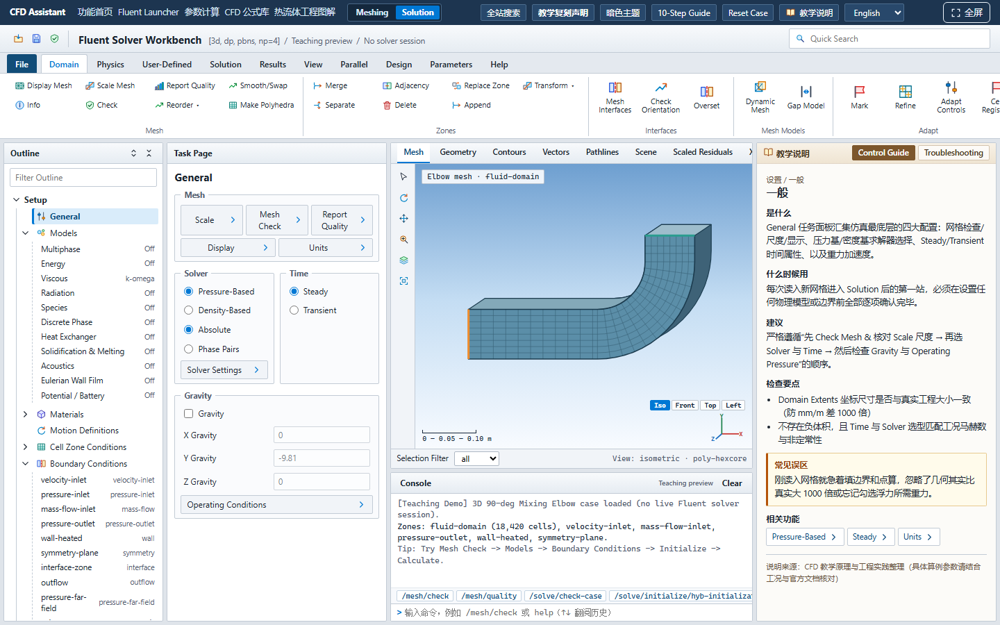
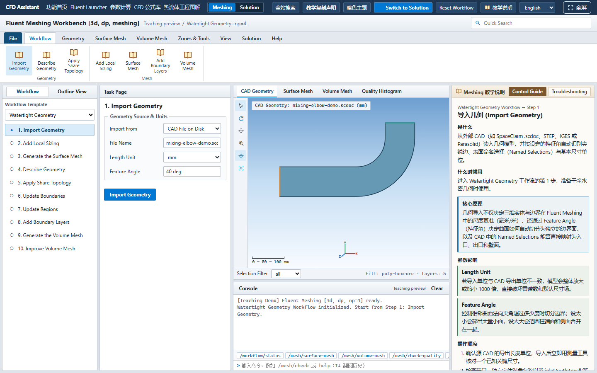
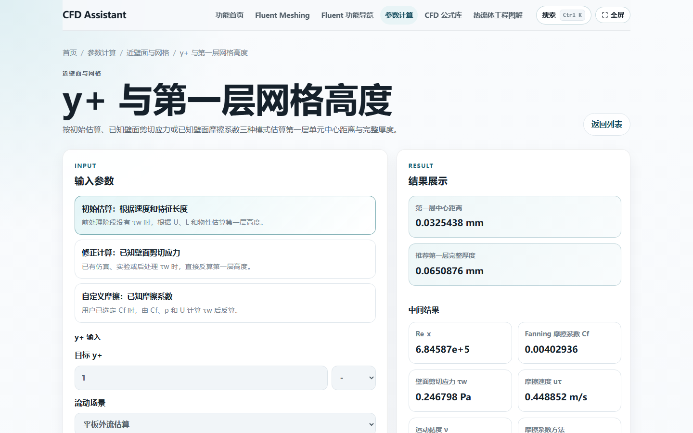
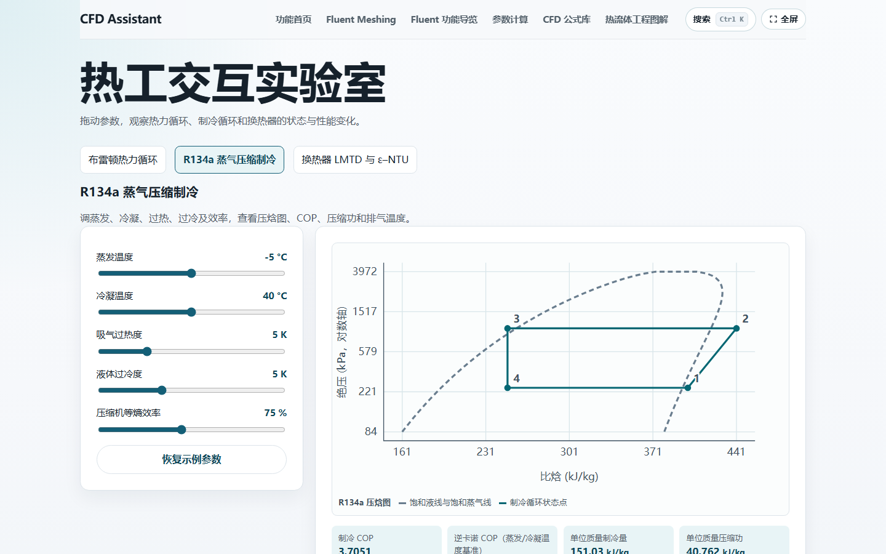

# CFD Assistant

面向 CFD 工程人员、能源动力专业同学与 Ansys Fluent 学习者的**开源纯前端工程辅助与交互教学工作台**。  
无需安装本地仿真软件，打开网页即可核对工况参数、换算物理单位、演练流体与热工循环，并在浏览器中交互练习 Fluent Meshing 与 Fluent Solution 设置逻辑。

🌐 **在线体验（GitHub Pages，随发布自动更新）**：[https://solnaut.github.io/cfd-assistant/](https://solnaut.github.io/cfd-assistant/)  
📦 **开源仓库**：[https://github.com/solnaut/cfd-assistant](https://github.com/solnaut/cfd-assistant) · [](LICENSE)

> [!IMPORTANT]
> **独立声明与工程使用边界**：本项目是完全独立的第三方开源教学与工程辅助工具，**不是 Ansys 官方产品**。所有教学模拟器均基于自主 HTML/CSS 构建，不连接本地或云端求解器，不执行真实 CFD 数值仿真，也不包含 Ansys / Fluent 官方 Logo、界面截图或大段帮助文档复制。计算器提供的估算结果仅供前处理参考与课堂核对，正式工程仿真请结合网格无关性检验、基准算例及试验数据复核。

---

## 核心功能模块

| 模块 | 访问路径 | 核心能力说明 |
| :--- | :--- | :--- |
| **功能首页与启动器** | `/`、`/fluent-launcher` | 融合“原理 → 网格 → 求解”三段学习路径，内置 **Fluent Launcher** 交互配置器（支持 2D/3D、单/双精度、Meshing/Solution 进程数、并行与显示驱动配置并带参数跳转）。 |
| **Fluent Solution 教学工作台** | `/fluent-guide` | 覆盖 Ribbon、模型树（Outline）、任务页面（Task Page）、3D 弯管流道视口、控制台 TUI（含常用快捷命令）与多层嵌套教学弹窗；支持中英界面切换、深浅色主题、10 步引导教程、报错排查与右侧“是什么 / 什么时候用 / 建议 / 检查要点 / 常见误区”结构化解析。 |
| **Fluent Meshing 网格工作台** | `/fluent-meshing` | 内置 **Watertight Geometry**（水密几何）、**Fault-Tolerant**（容错几何）与 **Multizone** 引导工作流，涵盖几何导入、BOI 局部加密、面网格、边界更新、边界层、体网格填充与正交质量直方图，支持一键将配置与边界流转到 Solution 工作台。 |
| **CFD 参数计算器（27 项）** | `/calculators` | 分为 **5 大专业分类**，均具备单位实时换算、输入边界校验、中间量输出、KaTeX 公式渲染、变量表与一键复制摘要；每项计算器均有独立研究记录与单元测试约束。 |
| **CFD 公式库** | `/formulas` | 与参数计算器共享单一数据源（无重复硬编码），按物理分类展示公式名称、KaTeX 数学排版、变量符号/物理含义及一键复制 LaTeX 源码。 |
| **热流体工程图解（36 节）** | `/knowledge` | 覆盖**流体力学、工程热力学、传热学、制冷技术原理** 4 门核心课程共 36 个专题；内置工程示意图解、跨学科知识框架图谱、本学科刷题自测、难度筛选、重点收藏与本地学习进度追踪。 |
| **热工交互实验室** | `/thermal-lab` | 提供 **布雷顿热力循环（T–s 图）**、**R134a 蒸气压缩制冷（lg p–h 压焓图，基于 CoolProp 7.2.0 教学物性表插值）**、**换热器 LMTD 与 ε–NTU（顺流/逆流/叉流）** 实时滑块实验。 |
| **CFD 实战向导** | `/cfd-practice` | 提供**模型与求解器选型向导**（按时间特征、马赫数、流态、热效应、多相流、旋转运动推荐基线并直达对应 Fluent 控件）与**不收敛/报错排查清单**。 |
| **工程单位换算器** | `/unit-converter` | 覆盖压力、热功率与冷量、动力/运动黏度、换热系数、热流密度、体积/质量流量、温度/温差等 **13 类物理量**，支持**绝压/表压切换**及**理想气体标况/工况流量换算**。 |
| **全站全局检索与 PWA** | `Ctrl + K` / `Cmd + K` | 跨热流体专题、Fluent 求解/网格控件、27 项参数计算器、公式、报错排查与 TUI 命令即时模糊检索与直达跳转；支持 PWA 安装与自动更新。 |

<details>
<summary>查看 27 项 CFD 参数计算器完整清单（5 大分类）</summary>

1. **近壁面与网格（3 项）**：`y+ 与第一层网格高度`（支持初始估算、已知壁面剪切应力 τw、已知壁面摩擦系数 Cf 三种模式，区分平板外流与管道内流 Darcy/Fanning 定义，自动生成等比边界层增长层高表并支持 CSV/表格复制）、`边界层网格等比增长`、`三网格收敛指数 GCI`（Richardson 外推、表观收敛阶与渐近区间比值）。
2. **瞬态与时间步长（3 项）**：`CFL 与时间步长`、`总时间步数量`、`旋转机械基础时间步长`。
3. **无量纲数（7 项）**：`Reynolds 数`、`Mach 数`、`Prandtl 数`、`Peclet 数`、`Grashof 数`、`Rayleigh 数`、`Nusselt 数基础形式`。
4. **流动与管路（7 项）**：`Fluent 入口湍流参数换算`（强度 + 水力直径 / 强度 + 湍流黏度比，输出 k、ε、ω 与长度尺度）、`水力直径`、`理想气体声速`、`管道压降`、`管内平均流速`、`体积流量与质量流量换算`、`层流管道沿程压降`。
5. **传热与热工（7 项）**：`Fourier 数`、`Biot 数`、`热通量`、`热阻`、`对流换热基本关系`、`导热基本关系`、`温升估算基础关系`。

</details>

---

## 界面预览

### 功能首页与 Fluent Launcher 配置器


### Fluent Solution 求解教学工作台（90° 弯管模型 + TUI + 右侧结构化解析）



### Fluent Meshing 网格工作台（水密/容错工作流引导）



### y+ 与第一层网格高度计算器（多模式 + 边界层网格推荐）



### 热流体工程图解（4 门核心课程 · 36 节专题 + 框架图谱 + 刷题自测）


### 热工交互实验室（R134a 蒸气压缩制冷 lg p–h 压焓图实时调参）



---

## 快速开始

### 方式 1：直接在线使用（推荐，自动保持最新版本）

直接用电脑、平板或手机浏览器打开：  
👉 **[https://solnaut.github.io/cfd-assistant/](https://solnaut.github.io/cfd-assistant/)**

站点内置 **PWA（Progressive Web App）自动更新机制**，浏览器支持的情况下也可添加到桌面作为独立应用离线查阅。

### 方式 2：Windows 一键启动 / 局域网与临时公网分享（无需懂 Git 命令）

1. 在本页面右上角点击绿色 **`<> Code`** → **`Download ZIP`**（或使用 Git 克隆）。
2. 确保本机已安装 [Node.js 20 / 22 LTS](https://nodejs.org/)。
3. 解压后可直接使用根目录的快捷脚本：
   - 双击 [启动 CFD Assistant.cmd](启动%20CFD%20Assistant.cmd)：自动检查依赖并在本地启动工作台、打开浏览器。
   - 双击 [停止 CFD Assistant.cmd](停止%20CFD%20Assistant.cmd)：一键安全关闭本地服务。
   - 双击 [公开分享 CFD Assistant.cmd](公开分享%20CFD%20Assistant.cmd)：先构建生产版本，再通过 Cloudflare Quick Tunnel 生成临时 `https://*.trycloudflare.com` 公网链接方便手机端或远程演示访问。

### 方式 3：Git 克隆与本地开发

> Windows PowerShell 默认可能受执行策略限制，仓库命令约定统一使用 `npm.cmd`。

```powershell
git clone https://github.com/solnaut/cfd-assistant.git
cd cfd-assistant
npm.cmd install
npm.cmd run dev
```

常用开发与发布脚本：

| 命令 | 用途 |
| :--- | :--- |
| `npm.cmd run dev` | 启动 Vite 本地开发服务器 |
| `npm.cmd run lint` | 运行 ESLint 代码静态检查 |
| `npm.cmd run test` | 运行 Vitest 自动化测试套件（当前 14 个测试文件、352 项用例） |
| `npm.cmd run typecheck` | 运行 TypeScript 类型检查（`tsc -b`） |
| `npm.cmd run build` | 执行类型检查并构建生产静态包至 `dist/` |
| `npm.cmd run screenshots` | 启动本地预览并通过无头浏览器自动刷新 `docs/screenshots/` 截图 |
| `npm.cmd run deploy:pages` | 构建 GitHub Pages 产物并一键发布至 `gh-pages` 分支 |

---

## 技术栈与目录架构

- **前端框架**：React 19 + TypeScript + Vite 8 + React Router 7
- **公式与离线能力**：KaTeX 数学排版 + `vite-plugin-pwa`（`registerType: 'autoUpdate'`）
- **质量保障**：ESLint + Vitest + React Testing Library + jsdom

项目严格遵循**视图与逻辑解耦**的工程分层约定（详见 [AGENTS.md](AGENTS.md) 与 [架构说明](docs/ARCHITECTURE.md)）：

```text
cfd-assistant/
├── public/
│   ├── knowledge/             # Fluent 演示知识库 JSON 与条目模板、教学插图
│   └── _redirects             # Cloudflare Pages SPA 路由回退配置
├── src/
│   ├── pages/                 # 页面级组件（仅负责布局、交互与状态组合）
│   ├── components/            # 通用 UI、图表、知识图谱与全局搜索弹窗
│   ├── calculators/           # 计算器目录、纯函数公式实现与热工物性数据
│   ├── units/                 # 物理量单位定义、标准换算与显示符号格式化
│   ├── knowledge/             # 热流体工程课程、实战向导与知识检索逻辑
│   ├── fluentMock/            # Fluent Solution & Meshing 教学模拟器与状态机
│   ├── search/                # 全站跨模块检索索引
│   ├── models/                # 共享 TypeScript 数据模型
│   └── tests/                 # 计算精度、单位换算、研究记录与页面交互测试
├── docs/
│   ├── screenshots/           # README 界面展示截图（由脚本自动采集）
│   ├── research/              # 计算器公式推导、Fluent 交互审计与参考来源记录
│   ├── ARCHITECTURE.md        # 系统架构与分层约定
│   ├── DEPLOYMENT.md          # GitHub Pages / Cloudflare Pages / 临时分享说明
│   └── github-actions-pages.yml.example  # GitHub Actions 自动部署工作流模板
└── scripts/
    ├── capture-screenshots.mjs # 自动化截图脚本
    ├── deploy-gh-pages.mjs     # GitHub Pages 一键发布脚本
    ├── open-workbench.ps1      # Windows 本地一键启动脚本
    └── share-workbench.mjs     # Cloudflare Quick Tunnel 临时公网分享脚本
```

---

## 自动更新与后续规划

- **在线站点更新机制**：
  - 每次版本更新可通过 `npm.cmd run deploy:pages` 直接推送 `gh-pages` 分支刷新线上页面；若在仓库 `.github/workflows/deploy-pages.yml` 启用 [GitHub Actions 工作流模板](docs/github-actions-pages.yml.example)，后续每次向 `main` 分支 `git push` 都会自动执行 `lint`、`test`、`build` 并更新 GitHub Pages。
  - 站点集成 PWA `autoUpdate` 与 `controllerchange` 自动刷新逻辑，访客再次打开站点时会自动获取新版本静态资源。
- **后续持续更新方向**：
  - 扩充传热、可压缩流、旋流与多相流相关经过权威验证的计算器条目；
  - 深化 Fluent Solution 多相流（VOF / Eulerian）、传热辐射、动网格与自定义函数（UDF）概念教学路径；
  - 持续完善移动端工作台分栏体验、经典算例（如弯管混合、平板边界层、换热器）的案例参数联动教学。

---

## 开源协议

本项目基于 [MIT License](LICENSE) 开源。
